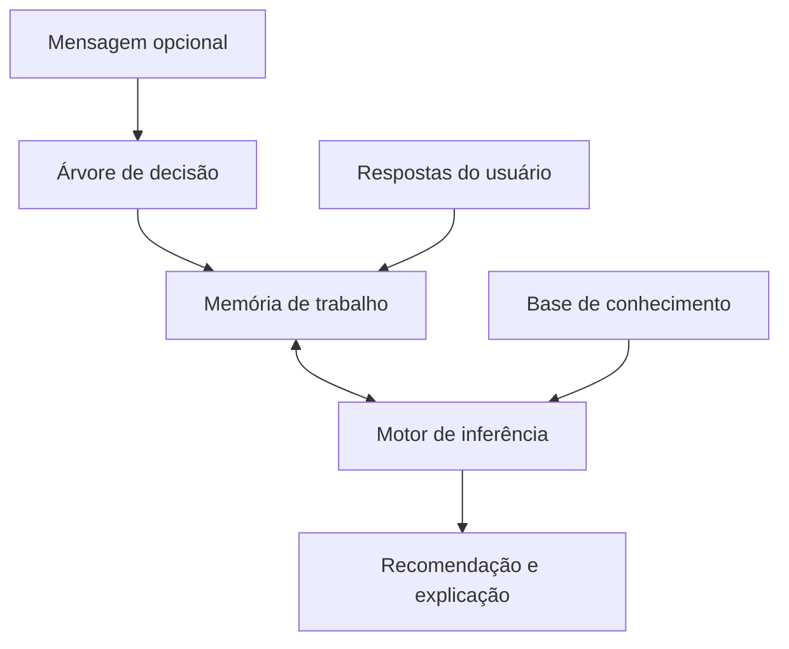

# Projeto Sistema Especialista

Sistema especialista para identificar golpes

UDF — Ciência da Computação  
Inteligência Artificial e Linguagens Formais e Autômatos — Profa. Kadidja Valéria

## Objetivo

O projeto ajuda a analisar contatos suspeitos em nome de bancos e operadoras. A árvore de decisão classifica o texto como `golpe` ou `legitimo`. O sistema especialista combina essa previsão com as respostas do usuário e apresenta uma orientação de segurança, explicando as regras usadas. O texto é opcional e as respostas podem ser sim, não ou não sei.

É um projeto didático: não confirma a identidade do remetente, não acessa contas e não substitui a instituição. Não utilize senhas, códigos ou dados reais.

## Como funciona



A base de conhecimento contém 52 regras e 19 perguntas. A memória registra os fatos da consulta. O motor aplica as regras por encadeamento para frente e para trás. A previsão vira o fato `ml_golpe`, usado na regra M1. A árvore aprende com os dados; as regras são definidas separadamente.

Exemplos: I3 identifica pedido de código, I4 identifica pedido de senha, S2 usa o indício de credencial para reforçar a suspeita e M1 utiliza a previsão do modelo. A origem das regras está no catálogo abaixo. Os pesos são heurísticos, não probabilidades. O motor evita acumular contribuições de mesmo sinal com suporte compartilhado e recalcula as conclusões quando uma resposta é corrigida. Informação ausente não significa resposta negativa.

O nível CRÍTICO se refere a possível exposição relatada, não a uma fraude comprovada. A exposição é investigada mesmo quando a suspeita é baixa. Uma previsão positiva sem sinais confirmados gera apenas alerta fraco.

## Dados e resultados

O dataset tem 100 mensagens fictícias, sendo 50 de cada classe: 40 exemplos anteriores revisados e 60 adicionais elaborados com auxílio de IA. Os rótulos representam a intenção do cenário simulado. Os nove atributos são extraídos do texto, sem usar o rótulo `perfil` como entrada. A divisão de treino e teste é 75/25, com estratificação e semente 42. A árvore usa profundidade máxima 3 e mínimo de dois registros por folha.

| Real / previsto | Golpe | Legítimo |
|---|---:|---:|
| Golpe | 10 | 3 |
| Legítimo | 7 | 5 |

Acurácia: 60% (15/25). Validação cruzada: 62% ± 4 pontos percentuais (desvio padrão). Sensibilidade para golpes: 76,9% (10/13). O resultado mostra limitações importantes: houve três golpes não detectados e sete falsos alarmes. Não é uma avaliação de eficácia real do sistema híbrido.

## Como executar

No [Google Colab](https://colab.research.google.com/), faça upload de `notebooks/sistema_especialista_golpes.ipynb` e execute as células em ordem. O notebook é autônomo. A consulta interativa é opcional; altere `CONSULTA_INTERATIVA` para `True` se desejar.

No computador, entre na pasta do projeto e execute:

```bash
python -m pip install -r requirements.txt
python src/sistema_golpes.py
python -m unittest discover -s tests -v
```

O módulo Python e as definições do notebook correspondem à mesma implementação. Se modificar o código, atualize também as células correspondentes.

## Organização

```text
Projeto Sistema Especialista/
├── data/dataset_mensagens_simulado.csv
├── notebooks/sistema_especialista_golpes.ipynb
├── src/sistema_golpes.py
├── tests/test_sistema_golpes.py
├── README.md
├── ETICA.md
├── requirements.txt
└── .gitignore
```

O notebook reúne as respostas ao estudo inicial, treinamento, matriz de confusão, árvore, regras, demonstração dos encadeamentos, três casos novos e discussão das limitações. O arquivo `ETICA.md` trata de privacidade, equidade, transparência e supervisão humana; os campos pessoais ainda devem ser preenchidos pelo estudante.

## Fundamentação complementar

No modelo PEAS: desempenho = reduzir erros e oferecer recomendações justificadas; ambiente = mensagens e relatos; atuadores = perguntas e orientações; sensores = texto e respostas. O ambiente real é parcialmente observável e dinâmico; a consulta é sequencial. O fluxo simplificado é coleta → inferência → resultado, retornando à coleta quando faltam fatos. Não se trata de um AFD formal nem de aprendizado contínuo.

## Referências

- Kadidja Valéria, Aula 12 — Sistemas Especialistas (pp. 9–26, 36–42).
- Kadidja Valéria, Aula 13 — Aprendizado de Máquina (pp. 3–7) e notebook de orientação de estudos.
- Russell e Norvig, *Inteligência artificial*, 3ª ed., cap. 2.
- Fontes de segurança e justificativas das regras: catálogo abaixo.

A revisão do código, dados simulados, notebook e documentação contou com auxílio de IA. A validação especializada e a reflexão individual permanecem pendentes.

## Informações complementares

<details>
<summary>Catálogo de regras e fontes</summary>

# Base de conhecimento

As regras estão em `criar_bc_golpes()`; o motor é independente do domínio. Cada registro possui identificador, premissas, conclusão, fator de certeza (CF), limiar e origem. Os fatores são **heurísticos, não probabilidades e não validados por especialista**. O sinal negativo representa evidência contra uma hipótese. Uma resposta ausente não significa falsa.

## Fontes de conhecimento

- FEB: [Febraban — falsa central](https://portal.febraban.org.br/DetalheAntifraude/2/pt-br), [falso motoboy](https://portal.febraban.org.br/DetalheAntifraude/3/pt-br/), [orientações sobre transações e acesso remoto](https://portal.febraban.org.br/DetalheNews/15/en-us). Consultadas em 23/11/2026. Sustentam os critérios gerais, não os pesos.
- BCB: [Banco Central — MED](https://www.bcb.gov.br/meubc/faqs/p/o-que-e-e-como-funciona-o-mecanismo-especial-de-devolucao-med) e [orientação em caso de fraude](https://www.bcb.gov.br/meubc/faqs/p/o-que-fazer-em-caso-de-golpe-fraude-ou-um-crime). O MED é exclusivo do Pix; recuperação não é garantida. Consultadas em 23/11/2026.
- HEUR: hipóteses de projeto, não validadas por especialistas; revisar antes de uso real.
- ML: classe prevista pela árvore treinada com dados simulados, utilizada como fato lógico. Não representa probabilidade real.

## Catálogo de regras

| ID | Premissas | Conclusão | CF | Limiar | Origem e justificativa |
|---|---|---|---:|---:|---|
| I1 | s_urgencia E s_contato_inesperado | i_pressao | +0.90 | 0.20 | HEUR: contato não solicitado com urgência é a tática central: o golpista quer que você aja antes de pensar. |
| I2 | s_urgencia | i_pressao | +0.60 | 0.20 | HEUR: urgência e ameaça de bloqueio são usadas para impedir que você confirme a história. |
| I3 | s_pede_codigo | i_pede_credencial | +0.90 | 0.20 | FEB: contatos inesperados que pedem códigos são suspeitos; não compartilhe códigos com terceiros. |
| I4 | s_pede_senha | i_pede_credencial | +0.95 | 0.20 | FEB: não forneça senha completa, CVV ou senha do cartão a um atendente por mensagem ou ligação. |
| I5 | s_numero_nao_oficial | i_canal_nao_oficial | +0.70 | 0.20 | FEB: o contato não veio de um canal que você possa confirmar como oficial (o número pode ser falsificado). |
| I6 | s_link | i_canal_nao_oficial | +0.60 | 0.20 | FEB: links de 'regularização' ou 'atualização de cadastro' enviados por mensagem são a principal porta do phishing. |
| I7 | s_pede_transferencia | i_pede_acao_financeira | +0.95 | 0.20 | FEB: pedir transferência a uma suposta conta segura para proteger dinheiro é sinal de fraude. |
| I8 | s_pede_pagar_taxa | i_pede_acao_financeira | +0.70 | 0.20 | HEUR: cobrar taxa para liberar benefício ou desbloquear conta é típico de golpe. |
| I9 | s_pede_app_remoto | i_pede_acesso_remoto | +0.95 | 0.20 | FEB: apps de acesso remoto deixam o golpista operar seu celular e o app do banco (golpe da 'mão fantasma'). |
| S1 | i_pressao E i_pede_credencial | suspeita_golpe | +0.90 | 0.20 | HEUR: pressão de tempo somada a pedido de credencial é o padrão clássico de golpe. |
| S2 | i_pede_credencial | suspeita_golpe | +0.75 | 0.20 | FEB: pedir código ou senha, por si só, já é sinal forte de golpe. |
| S3 | i_pede_acao_financeira | suspeita_golpe | +0.80 | 0.20 | FEB: pedido de movimentação de dinheiro iniciado pelo atendente é sinal forte de golpe. |
| S4 | i_pede_acesso_remoto | suspeita_golpe | +0.90 | 0.20 | FEB: pedido de acesso remoto é um dos sinais mais graves. |
| S5 | i_pressao E i_canal_nao_oficial | suspeita_golpe | +0.70 | 0.20 | HEUR: urgência vinda de canal não oficial indica tentativa de induzir ação precipitada. |
| S6 | s_cita_compra_suspeita E i_canal_nao_oficial | suspeita_golpe | +0.60 | 0.20 | FEB: 'compra suspeita' por canal não oficial é o gancho mais usado pela falsa central. |
| S7 | s_cita_compra_suspeita E s_contato_inesperado | suspeita_golpe | +0.40 | 0.20 | HEUR: bancos reais também avisam sobre fraude, por isso o peso é só moderado sem outros sinais. |
| S8 | s_pede_entregar_cartao | suspeita_golpe | +0.95 | 0.20 | FEB: a retirada do cartão por suposto funcionário é sinal grave de possível golpe do motoboy. |
| S9 | s_promessa_beneficio E s_link | suspeita_golpe | +0.70 | 0.20 | HEUR: prêmio ou benefício acompanhado de link é padrão de phishing. |
| S10 | s_promessa_beneficio E s_contato_inesperado | suspeita_golpe | +0.45 | 0.20 | HEUR: ofertas que você não pediu merecem desconfiança. |
| S11 | s_pede_pagar_taxa E s_promessa_beneficio | suspeita_golpe | +0.80 | 0.20 | HEUR: pagar para receber prêmio ou liberação é o roteiro da falsa oferta. |
| S12 | s_voce_iniciou E NÃO s_numero_nao_oficial | suspeita_golpe | -0.40 | 0.20 | FEB: você ligou para o número oficial, o que reduz o risco (mas golpistas podem manter a linha aberta; nunca informe código ou senha). |
| M1 | ml_golpe | suspeita_golpe | +0.50 | 0.20 | ML: o modelo de ML, treinado com mensagens simuladas, achou o texto parecido com golpes (só reforça: sem sinal confirmado nas respostas, vira apenas um 'alerta fraco'). |
| T1 | s_cita_compra_suspeita E i_pede_acao_financeira | t_conta_segura | +0.90 | 0.20 | FEB: compra suspeita + pedido de transferência é o golpe da conta segura. |
| T2 | s_pede_transferencia E s_urgencia | t_conta_segura | +0.60 | 0.20 | HEUR: pedido urgente de transferência lembra o golpe da conta segura. |
| T3 | s_pede_entregar_cartao | t_motoboy | +0.95 | 0.20 | FEB: retirada do cartão por portador é o golpe do motoboy. |
| T4 | s_pede_entregar_cartao E s_cita_compra_suspeita | t_motoboy | +0.90 | 0.20 | FEB: o motoboy costuma vir após a história da compra suspeita. |
| T5 | i_pede_acesso_remoto | t_acesso_remoto | +0.90 | 0.20 | FEB: instalação de app de acesso remoto caracteriza o golpe do acesso remoto. |
| T6 | s_pede_codigo | t_roubo_credenciais | +0.80 | 0.20 | FEB: o código serve para o golpista entrar na sua conta ou clonar seu WhatsApp. |
| T7 | s_pede_senha | t_roubo_credenciais | +0.80 | 0.20 | FEB: senha ou CVV permitem acesso direto às suas contas e ao cartão. |
| T8 | s_link E i_canal_nao_oficial | t_phishing_link | +0.80 | 0.20 | FEB: link por canal não oficial costuma levar a site falso que captura dados. |
| T9 | s_link | t_phishing_link | +0.50 | 0.20 | HEUR: qualquer link de regularização pode levar a site falso. |
| T10 | s_promessa_beneficio E s_pede_pagar_taxa | t_falsa_oferta | +0.90 | 0.20 | HEUR: prêmio condicionado a pagamento de taxa é a falsa oferta. |
| T11 | s_promessa_beneficio | t_falsa_oferta | +0.50 | 0.20 | HEUR: promessa de benefício não solicitado sugere falsa oferta. |
| N1 | suspeita_golpe | f_alerta | +1.00 | 0.40 | HEUR: suspeita moderada ou alta. |
| D1 | a_passou_codigo | i_houve_dano | +1.00 | 0.20 | HEUR: Exposição relatada ou ação derivada da condição; confirmar o contexto. |
| D2 | a_passou_senha | i_houve_dano | +1.00 | 0.20 | HEUR: Exposição relatada ou ação derivada da condição; confirmar o contexto. |
| D3 | a_instalou_app | i_houve_dano | +1.00 | 0.20 | HEUR: Exposição relatada ou ação derivada da condição; confirmar o contexto. |
| D4 | a_fez_transferencia | i_houve_dano | +1.00 | 0.20 | HEUR: Exposição relatada ou ação derivada da condição; confirmar o contexto. |
| D5 | a_entregou_cartao | i_houve_dano | +1.00 | 0.20 | HEUR: Exposição relatada ou ação derivada da condição; confirmar o contexto. |
| D6 | a_clicou_link | i_houve_dano | +1.00 | 0.20 | HEUR: Exposição relatada ou ação derivada da condição; confirmar o contexto. |
| A1 | a_fez_transferencia | ac_contestar_pix | +1.00 | 0.20 | BCB: Exposição relatada ou ação derivada da condição; confirmar o contexto. |
| A2 | a_entregou_cartao | ac_bloquear_cartao | +1.00 | 0.20 | FEB: Exposição relatada ou ação derivada da condição; confirmar o contexto. |
| A3 | a_instalou_app | ac_remover_app | +1.00 | 0.20 | FEB: Exposição relatada ou ação derivada da condição; confirmar o contexto. |
| A4 | a_passou_senha | ac_trocar_senha | +1.00 | 0.20 | FEB: Exposição relatada ou ação derivada da condição; confirmar o contexto. |
| A5 | a_passou_codigo | ac_trocar_senha | +1.00 | 0.20 | FEB: Exposição relatada ou ação derivada da condição; confirmar o contexto. |
| A6 | a_clicou_link | ac_trocar_senha | +0.90 | 0.20 | HEUR: Exposição relatada ou ação derivada da condição; confirmar o contexto. |
| A7 | i_houve_dano | ac_ligar_banco | +1.00 | 0.20 | FEB: Exposição relatada ou ação derivada da condição; confirmar o contexto. |
| A8 | i_houve_dano | ac_bo | +1.00 | 0.20 | HEUR: Exposição relatada ou ação derivada da condição; confirmar o contexto. |
| A9 | i_houve_dano | ac_monitorar | +1.00 | 0.20 | HEUR: Exposição relatada ou ação derivada da condição; confirmar o contexto. |
| A10 | f_alerta | ac_encerrar | +1.00 | 0.20 | FEB: Exposição relatada ou ação derivada da condição; confirmar o contexto. |
| A11 | f_alerta | ac_canal_oficial | +1.00 | 0.20 | FEB: Exposição relatada ou ação derivada da condição; confirmar o contexto. |
| A12 | f_alerta | ac_bloquear_denunciar | +1.00 | 0.20 | HEUR: Exposição relatada ou ação derivada da condição; confirmar o contexto. |

## Fatos consultáveis

- `s_contato_inesperado`: Você foi contatado sem ter pedido nada (ligação, SMS, WhatsApp ou e-mail)?
- `s_numero_nao_oficial`: O número ou remetente é diferente do oficial (verso do cartão, app ou site)?
- `s_urgencia`: Falaram em urgência, bloqueio da conta ou prazo curto para você agir?
- `s_cita_compra_suspeita`: Disseram que houve uma compra ou movimentação suspeita na sua conta?
- `s_pede_codigo`: Pediram algum código (SMS, token, e-mail ou do aplicativo)?
- `s_pede_senha`: Pediram senha, CVV ou a senha do cartão?
- `s_pede_app_remoto`: Pediram para instalar um aplicativo ou liberar acesso remoto ao seu celular/computador?
- `s_pede_transferencia`: Pediram Pix, transferência ou depósito (por exemplo, para uma 'conta segura')?
- `s_pede_entregar_cartao`: Disseram que alguém iria buscar ou que você deveria entregar seu cartão?
- `s_link`: Enviaram um link para 'regularizar', 'desbloquear' ou 'atualizar cadastro'?
- `s_promessa_beneficio`: Ofereceram prêmio, aumento de limite, cashback ou desconto?
- `s_pede_pagar_taxa`: Pediram pagamento de taxa, boleto ou tarifa para liberar algo?
- `s_voce_iniciou`: Foi VOCÊ quem iniciou o contato, ligando para o número oficial (cartão, app ou site)?
- `a_passou_codigo`: Você chegou a informar algum código ao contato suspeito? Não digite o código aqui.
- `a_passou_senha`: Você chegou a informar senha ou CVV ao contato suspeito? Não digite os dados aqui.
- `a_instalou_app`: Você instalou o aplicativo ou liberou o acesso remoto?
- `a_fez_transferencia`: Você chegou a fazer um Pix, transferência ou pagamento solicitado nesse contato suspeito?
- `a_entregou_cartao`: Você entregou o cartão (ou deixou alguém buscá-lo)?
- `a_clicou_link`: Você inseriu dados sensíveis em um link suspeito? (Apenas clicar não confirma exposição de credenciais.)

</details>

<details>
<summary>Resultados detalhados do modelo</summary>

# Avaliação do modelo

Ambiente local: Python 3.13.5, pandas 2.2.3, scikit-learn 1.8.0, matplotlib 3.10.8.

- 100 mensagens simuladas: 50 de cada classe. Treino: 75; teste: 25. `random_state=42`, divisão estratificada, profundidade 3, mínimo 2 registros por folha.
- Acurácia de treino: 74.7%; teste: 60.0%; validação cruzada (5 divisões estratificadas): 62.0% ± 4.0% (desvio padrão, não intervalo de confiança).
- Matriz de confusão (real nas linhas; previsto nas colunas):

| Real / previsto | golpe | legitimo |
|---|---:|---:|
| golpe | 10 | 3 |
| legitimo | 7 | 5 |

```text
              precision    recall  f1-score   support

       golpe       0.59      0.77      0.67        13
    legitimo       0.62      0.42      0.50        12

    accuracy                           0.60        25
   macro avg       0.61      0.59      0.58        25
weighted avg       0.61      0.60      0.59        25

```

## Erros no teste

| Linha (1-based, sem cabeçalho) | Texto simulado | Real | Previsto |
|---:|---|---|---|
| 34 | O prazo para declarar o imposto termina em breve. Veja o guia no site oficial https://gov.example.invalid/guia | legitimo | golpe |
| 85 | O pagamento agendado foi processado; confira o comprovante no aplicativo. | legitimo | golpe |
| 40 | Informe-nos sua opinião: avalie o atendimento em até 3 dias no aplicativo. | legitimo | golpe |
| 28 | Aviso: nunca informe senha ou código por telefone. O banco nunca solicita esses dados. | legitimo | golpe |
| 8 | Cashback de R$ 500 liberado! Pague a taxa de liberação de R$ 29,90 via Pix para receber seu prêmio. | golpe | legitimo |
| 97 | O serviço de mensagens ficará indisponível durante a manutenção. | legitimo | golpe |
| 11 | BANCO EXEMPLO: SUA CONTA SERÁ ENCERRADA HOJE!!! ACESSE https://exemplo-banco.example.invalid E CONFIRME SEUS DADOS AGORA!!! | golpe | legitimo |
| 78 | Se você não reconhece a compra, abra o aplicativo oficial por conta própria. | legitimo | golpe |
| 19 | Boleto de regularização pendente. Pague agora via Pix para liberar seu limite. Chave aleatória abaixo. | golpe | legitimo |
| 94 | Comunicado: a instituição não recolhe cartões na residência. | legitimo | golpe |

## Interpretação

A acurácia de 60% é inferior aos 80% registrados na versão anterior, que tinha 40 mensagens e apenas 10 casos de teste. Os conjuntos e os atributos mudaram: não é uma comparação controlada. A sensibilidade a golpes no teste atual é 10/13 (76,9%), e existem 7 falsos positivos. Não foi feito ajuste repetido para melhorar a métrica neste teste. O conjunto continua pequeno, simulado e não representativo de uma população real. A árvore é uma evidência auxiliar; não há autorização para uso operacional. A próxima avaliação deve utilizar dados inéditos, revisão humana dos rótulos e um conjunto de teste independente. O relatório avalia o classificador, não a eficácia real de toda a triagem híbrida.

A suíte de testes verifica comportamento lógico e de integração; não mede acurácia em fraude real. Os testes de falsos positivos e negativos controlados injetam explicitamente uma previsão incorreta em vez de depender de uma frase que o modelo necessariamente erre.

</details>

<details>
<summary>Análise dos três casos</summary>

# Três novos casos — Aula 13

Exemplos fictícios separados do dataset de 100 mensagens. Resultados executados localmente; são demonstrações, não validação externa.

## 1 — Pedido de senha

Mensagem simulada: Olá, aqui é da central. Para cancelar uma compra, precisamos que você informe a senha do cartão.

Rótulo de referência do cenário: golpe. Fatos positivos: s_pede_senha, s_contato_inesperado. Demais fatos negados.

Previsão: `golpe`. CF de suspeita: 0.856. Suspeita: **ALTO**. Orientação: **ALTO**.

Regras selecionadas: A10, A11, A12, I4, M1, N1, S2, T7

Recomendações:
- Encerre o contato agora (desligue ou pare de responder) e não siga nenhuma instrução recebida.
- Para confirmar, desligue e ligue você mesmo para o número oficial do verso do cartão ou do aplicativo, de preferência de outro aparelho (o golpista pode manter a linha aberta); nunca retorne para o número que te procurou.
- Bloqueie o número ou remetente e denuncie na própria plataforma (WhatsApp, SMS, e-mail).

O modelo sinaliza a mensagem e I4/S2 sustentam a suspeita; a regra M1 reforça.

## 2 — Mensagem informativa

Mensagem simulada: Seu pacote mensal está disponível para consulta no aplicativo habitual.

Rótulo de referência do cenário: legitimo. Fatos positivos: nenhum. Demais fatos negados.

Previsão: `golpe`. CF de suspeita: 0.500. Suspeita: **ALERTA FRACO**. Orientação: **ALERTA FRACO**.

Regras selecionadas: M1

Recomendações:
- Alerta fraco: o texto da mensagem lembra golpes, mas nenhum sinal confirmado por você reforça essa suspeita. Pode ser um alarme falso (cobranças e avisos legítimos às vezes parecem golpe). Revise suas respostas e, na dúvida, confirme pelo canal oficial; não informe códigos nem senhas.

Falso positivo: a previsão não basta para confirmar fraude. M1 gera apenas alerta fraco.

## 3 — Exposição com informação insuficiente

Mensagem simulada: O atendimento está concluído. Obrigado.

Rótulo de referência do cenário: indeterminado. Fatos positivos: a_passou_codigo. Demais fatos desconhecidos.

Previsão: `legitimo`. CF de suspeita: 0.000. Suspeita: **INCOMPLETO**. Orientação: **CRÍTICO**.

Regras selecionadas: A5, A7, A8, A9, D1

Recomendações:
- Troque agora as senhas do banco e do e-mail, encerre sessões/dispositivos conectados e, se informou a senha do cartão, peça a troca ou o bloqueio.
- Avise o banco, pelo canal oficial, sobre a possível exposição para que ele oriente a proteção da conta.
- Registre boletim de ocorrência (delegacia virtual do seu estado) e guarde prints, números de telefone, horários e comprovantes.
- Ative alertas de transações e acompanhe o extrato nos próximos dias; desconfie de novos contatos sobre o mesmo assunto.

A classe legítimo não reduz a suspeita; D1/A5/A7 indicam proteção por exposição relatada. Não se confirma fraude pela mensagem.

</details>

