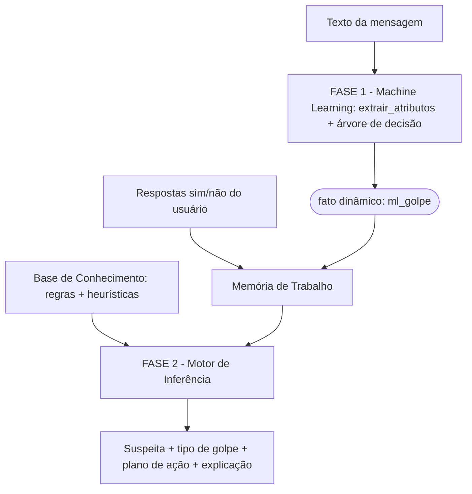

# Sistema Especialista com Aprendizado Supervisionado: triagem de golpes de falsa central de atendimento

[](https://colab.research.google.com/github/SEU_USUARIO/SEU_REPOSITORIO/blob/main/notebooks/sistema_especialista_golpes.ipynb)

> **Disciplina:** Inteligência Artificial e LFA | Sistemas Especialistas
> **Tema:** filtragem de mensagens/contatos indesejados
> **Aviso:** os dados de treino são **fictícios (simulados)**, escritos para fins didáticos. Este projeto **não valida** uma ferramenta de segurança real e **não substitui** o atendimento oficial do banco ou da operadora.

Sistema especialista **híbrido** que ajuda uma pessoa a decidir se um contato recebido (ligação, SMS, WhatsApp, e-mail) que diz ser do **banco ou da operadora** é um golpe. Ele entrega:

1. um **grau de suspeita** (com fatores de certeza, estilo MYCIN);
2. o **tipo provável de golpe** (conta segura, motoboy, acesso remoto, roubo de código/senha, phishing por link, falsa oferta);
3. um **plano de ação personalizado** (muda se a pessoa já passou código, instalou app, fez Pix...);
4. a **explicação** de cada conclusão, com a regra usada e a fonte do critério.

---

## 1. O problema (entradas, rótulo e recomendação)

**Problema do dia a dia:** golpistas se passam por banco ou operadora para roubar códigos, senhas e dinheiro, pressionando a vítima a agir rápido. Quem recebe o contato precisa decidir na hora se ele é confiável.

| Item | Definição |
|---|---|
| **Entradas** | (1) o texto da mensagem recebida (opcional); (2) respostas **sim/não/não sei** sobre o contato (pediu código? pediu Pix? ...) |
| **Rótulo do modelo de ML** | `perfil` da mensagem: `golpe` ou `legitimo` |
| **Saída (recomendação)** | grau de suspeita + tipo de golpe + plano de ação + explicação |

## 2. Como funciona (arquitetura híbrida em duas fases)



- **Fase 1 (aprendizado supervisionado):** uma árvore de decisão lê o texto (transformado em 6 números) e prevê `golpe` ou `legitimo`. A previsão entra como **fato dinâmico** (`ml_golpe`) na Memória de Trabalho.
- **Fase 2 (sistema especialista):** as regras escritas por pessoas combinam esse fato com as respostas do usuário e decidem. O ML é só um **apoio de peso moderado**: sozinho ele não gera um alerta alto.

### Correspondência com o guia da disciplina

O guia *Sistemas Especialistas: guia completo (IA)* define três componentes. Veja onde cada um está (o guia usa "facto/utilizador"; aqui, "fato/usuário"):

| Componente (guia) | No projeto |
|---|---|
| **Base de conhecimento: factos** | respostas do usuário (`s_*`, `a_*`) e previsão do modelo (`ml_golpe`) |
| **Base de conhecimento: regras** | classe `Regra` + lista em `criar_bc_golpes()` (53 regras) |
| **Base de conhecimento: heurísticas** | pesos `cf`, limiares (`LIMIAR`, `NIVEL_ALTO`, `NIVEL_MODERADO`, `MIN_INFO`) e curto-circuito que só pergunta o necessário |
| **Motor de inferência** | `MotorInferencia`: `encadeamento_frente` (progressivo) e `avaliar` (regressivo) |
| **Interface de utilizador** | `provedor_cli`, `mostrar` e `main` |

Além disso, usamos a **Memória de Trabalho** (do tratado de sistemas especialistas) para guardar os fatos da consulta atual.

## 3. Estrutura do repositório

```
.
├── README.md                                   <- este arquivo
├── requirements.txt                            <- dependências
├── .gitignore
├── notebooks/
│   └── sistema_especialista_golpes.ipynb       <- entrega principal (já executado; roda no Colab)
├── src/
│   └── sistema_golpes.py                       <- o mesmo código, como módulo Python
├── tests/
│   └── test_sistema_golpes.py                  <- 82 testes automáticos
└── data/
    └── dataset_mensagens_simulado.csv          <- dataset simulado (40 mensagens + atributos + rótulo)
```

## 4. Como executar

**No Google Colab (recomendado):** *Arquivo > Fazer upload de notebook* e selecione `notebooks/sistema_especialista_golpes.ipynb`; depois *Ambiente de execução > Executar tudo*. A última célula é a consulta interativa.
Se aparecer `ModuleNotFoundError`, rode em uma célula: `%pip install pandas scikit-learn matplotlib`.

**Localmente:**

```bash
pip install -r requirements.txt
python src/sistema_golpes.py                  # consulta interativa no terminal
python -m unittest discover -s tests -v       # roda os 82 testes
```

## 5. Guia do código: o que é cada coisa

### Fase 1: machine learning

| Nome | O que é / o que faz |
|---|---|
| `MENSAGENS_SIMULADAS` | Lista de 40 pares (texto, rótulo) **simulados**: a matéria-prima do treino. |
| `ATRIBUTOS` | Os 6 atributos (colunas de `X`): `n_links`, `n_urgencia`, `n_dados_sensiveis`, `n_verbos_pedido`, `n_exclamacoes`, `pct_maiusculas`. O rótulo **nunca** entra aqui. |
| `normalizar(texto)` | Remove acentos e põe em minúsculas, para "Código" e "codigo" serem a mesma palavra. |
| `extrair_atributos(texto)` | **A ponte entre texto e ML.** Transforma uma mensagem nos 6 números que o classificador entende. |
| `construir_dataset()` | Monta o `DataFrame` (texto + atributos + rótulo) usando `extrair_atributos`, garantindo o mesmo cálculo no treino e no uso real. |
| `ResultadoTreino` | "Pacote" com modelo, divisões treino/teste, previsões e métricas. |
| `treinar_modelo(dados)` | Fluxo completo supervisionado: separa `X`/`y`, divide treino/teste (estratificado, `random_state=42`), treina a árvore (`max_depth=3`), mede acurácia, matriz de confusão e validação cruzada. |
| `obter_resultado_padrao()` | Treina uma vez e reaproveita (cache). |
| `classificar_mensagem(texto)` | **Fase 1 em uso:** devolve classe, probabilidade de golpe e aviso se a entrada está fora do intervalo visto no treino. |
| `prob_para_cf(p)` | Converte probabilidade em fator de certeza: `(p - 0.5) × 2` (50% vira 0; 100% vira +1). |

### Fase 2: sistema especialista

| Nome | O que é / o que faz |
|---|---|
| `combinar(a, b)` | Combina dois fatores de certeza da mesma conclusão (fórmula do MYCIN); resultado sempre entre -1 e +1. |
| `premissa_ok(cf, esperado, limiar)` | Diz se uma premissa está satisfeita (verdadeira: `cf ≥ limiar`; negada: `cf ≤ -limiar`). |
| `Regra` / `Regra.criar` | **Regra SE-ENTÃO** com `cf`, justificativa (`nota`) e `fonte`. `Regra.criar("S2", "a & !b", "x", 0.7)` escreve a regra como texto (`!` = fato falso). |
| `BaseConhecimento` | **Conhecimento estático:** perguntas, regras, rótulos, tipos de golpe e ações. Tem `verificar()`, que procura regras duplicadas, premissas inalcançáveis, ciclos, pesos inválidos e itens sem uso. |
| `MemoriaTrabalho` | **Memória dinâmica** da consulta: fatos com seus fatores de certeza, a origem de cada um e o que foi respondido "não sei". |
| `MotorInferencia` | **O "cérebro".** Não conhece golpes; só cruza fatos com regras. |
| `MotorInferencia.encadeamento_frente()` | **Encadeamento progressivo:** parte dos fatos da memória e deduz tudo o que for possível. |
| `MotorInferencia.avaliar(fato, provedor)` | **Encadeamento regressivo:** parte de um objetivo e só pergunta o necessário (curto-circuito). Devolve `None` se o dado for desconhecido. |
| `MotorInferencia.explicar()` | **Explicação:** evidências, leitura do ML e regras que pesaram, com justificativa e fonte. |
| `criar_bc_golpes()` | Constrói a base de conhecimento do domínio. Para outro assunto, basta escrever outra função assim. |
| `classificar_nivel(cf, n)` | Transforma a certeza em ALTO/MODERADO/BAIXO/INCOMPLETO; só declara "baixo" se houver informação suficiente. |
| `Diagnostico` | O resultado final entregue ao usuário (suspeita, nível, tipos, ações, explicação, leitura do ML, aviso). |
| `diagnosticar(bc, provedor)` | Resolve 3 objetivos por encadeamento regressivo: suspeita, tipo de golpe e plano de ação. |
| `analisar_contato(bc, provedor, texto)` | **Integração:** roda a Fase 1 (se houver texto), coloca `ml_golpe` na memória e roda a Fase 2. |

### Interface

| Nome | O que é / o que faz |
|---|---|
| `provedor_cli(fato, pergunta)` | Faz a pergunta no terminal/Colab: `s` → sim, `n` → não, Enter → não sei. |
| `mostrar(diagnostico)` | Imprime o resultado completo. |
| `main()` | Ciclo de consultas interativas. |

## 6. Base de conhecimento: regras e origem (item 2 da atividade)

São **19 perguntas** (13 sobre o contato e 6 sobre o que a pessoa já fez), **1 fato externo** (`ml_golpe`) e **53 regras** em camadas:

| Camada | Regras | O que faz |
|---|---|---|
| Evidências (`I`) | sinais brutos → evidências | ex.: pediu código → *pede credencial* |
| Suspeita (`S`) e ML (`M`) | evidências → grau de suspeita | combina fatores de certeza; `M1`/`M2` trazem o apoio do modelo |
| Tipo de golpe (`T`) | classifica o golpe | conta segura, motoboy, acesso remoto, código/senha, phishing, falsa oferta |
| Nível (`N`), danos (`D`) e ações (`A`) | plano de ação | só pergunta "o que você já fez?" se houver alerta |

Contagem por camada: `I`: 9 · `S`: 12 · `M`: 2 · `T`: 11 · `N`: 1 · `D`: 6 · `A`: 12.

**Origem do critério de cada regra** (campo `fonte`): `BCB`: 1 · `FEB`: 26 · `HEUR`: 24 · `ML`: 2.

| Código | Significado |
|---|---|
| `FEB` | Orientações públicas da Febraban (campanha antifraudes "Pare & Pense #Pode ser Golpe" e dicas antigolpe) |
| `BCB` | Banco Central do Brasil (Mecanismo Especial de Devolução, o MED do Pix) |
| `HEUR` | Heurística do autor, **a validar com especialista** |
| `ML` | Modelo de aprendizado de máquina (Fase 1) |

> **Importante:** o campo `fonte` indica de onde vem o **critério** (ex.: "banco nunca pede código"). Os **valores numéricos** (`cf`) foram **calibrados pelo autor** e precisam de validação por especialistas em fraude.

**Critérios com fonte pública:** banco **nunca** pede senha, código ou transferência; banco **não** manda motoboy buscar cartão; na dúvida, **desligar e ligar para o número oficial, de preferência de outro aparelho** (o golpista pode manter a linha aberta); não clicar em links de "atualização de cadastro"; após um Pix indevido, acionar o banco rapidamente para pedir o **MED**.

### Fontes consultadas

Reportagens e materiais que citam orientações da Febraban e do Banco Central. Confirme nas fontes oficiais antes de citar no trabalho:

- Febraban, campanha antifraudes "Pare & Pense #Pode ser Golpe": antifraudes.febraban.org.br
- Banco Central do Brasil, FAQ sobre o MED: https://www.bcb.gov.br/meubc/faqs/p/o-que-e-e-como-funciona-o-mecanismo-especial-de-devolucao-med
- Consumidor Moderno, golpe da falsa central bancária: https://consumidormoderno.com.br/golpe-falsa-central-bancaria-cm/
- Fast Company Brasil, golpe do falso gerente alertado pela Febraban: https://fastcompanybrasil.com/money/entenda-golpe-do-falso-gerente-alertado-pela-febraban/
- O Povo, federação de bancos alerta para golpes a contas bancárias: https://www.opovo.com.br/noticias/economia/2024/04/02/federacao-de-bancos-alerta-para-golpes-a-contas-bancarias-veja-dicas.html
- Safra, cuidados contra golpes financeiros: https://oespecialista.safra.com.br/cuidados-contra-golpes-financeiros/

O prazo e as condições do MED mudam com o tempo: o sistema orienta a **confirmar o prazo atual no site do Banco Central**.

## 7. Dataset (item 3 da atividade)

- **Origem:** 40 mensagens **escritas pelo autor (simuladas)**, imitando padrões públicos de golpes (falsa central, motoboy, acesso remoto, código por SMS, falsa oferta) e mensagens informativas típicas de bancos/operadoras. Nenhuma mensagem real e nenhum nome real foram usados.
- **Tamanho:** 40 exemplos, **20 `golpe` e 20 `legitimo`**. Arquivo: [`data/dataset_mensagens_simulado.csv`](data/dataset_mensagens_simulado.csv).
- **Critério de rotulagem:** `golpe` se segue um roteiro conhecido (pede código, senha, Pix, instalação de app, entrega de cartão, ou pressiona com urgência + link); `legitimo` se apenas informa algo (compra aprovada, fatura, aviso).
- **Casos difíceis incluídos de propósito:** mensagens legítimas com link ou prazo, e golpes sem link, para o problema não ser trivial.
- **Limitação:** rotulagem feita por **uma única pessoa**, sem revisão independente.

| Atributo | O que mede |
|---|---|
| `n_links` | quantidade de links |
| `n_urgencia` | termos de urgência/ameaça (agora, hoje, bloqueio, prazo...) |
| `n_dados_sensiveis` | termos sensíveis (senha, código, CPF, Pix, token...) |
| `n_verbos_pedido` | verbos de comando (informe, confirme, clique, instale...) |
| `n_exclamacoes` | quantidade de `!` |
| `pct_maiusculas` | percentual de letras maiúsculas |

## 8. Resultados do modelo (item 4 da atividade)

Divisão **75/25** estratificada (`random_state=42`): **30 exemplos de treino e 10 de teste**. Modelo: `DecisionTreeClassifier(max_depth=3, min_samples_leaf=2)`.

| Métrica | Valor |
|---|---|
| Acurácia no teste | **80.0%** |
| Validação cruzada (5 divisões) | 85.0% (± 9.4%) |

**Matriz de confusão** (linhas = real, colunas = previsto):

| | previsto: golpe | previsto: legitimo |
|---|---|---|
| **real: golpe** | 3 | 2 |
| **real: legitimo** | 0 | 5 |

**Regras aprendidas pela árvore:**

```
|--- n_verbos_pedido <= 0.50
|   |--- class: legitimo
|--- n_verbos_pedido >  0.50
|   |--- n_urgencia <= 0.50
|   |   |--- pct_maiusculas <= 4.95
|   |   |   |--- class: legitimo
|   |   |--- pct_maiusculas >  4.95
|   |   |   |--- class: golpe
|   |--- n_urgencia >  0.50
|   |   |--- class: golpe
```

**Exemplos de teste errados (2):**

| Texto | Real | Previsto |
|---|---|---|
| Aqui é do setor antifraude. Precisamos validar seu CPF e a senha do cartão para estornar a compra indevida. | golpe | legitimo |
| Devolução disponível: informe seu token e faça uma transferência de validação de R$ 1,00. | golpe | legitimo |

**Como interpretar (com honestidade):**

- Com apenas **10 casos de teste** e dados escritos por uma só pessoa, a acurácia **não demonstra eficácia em situações reais**. A validação cruzada ajuda a ver a estabilidade, mas não foi usada para escolher parâmetros.
- Os erros são **golpes sem palavras de urgência**: para quem só conta palavras, parecem mensagens comuns.
- A árvore acerta 100% no treino e menos no teste, sinal de **overfitting** leve.
- As probabilidades de uma árvore são **pouco calibradas** (tendem a 0% ou 100%). Por isso o ML entra nas regras com **peso moderado** (`M1`: +0,5; `M2`: -0,2) e **nunca decide sozinho**.

## 9. Exemplo de saída

Cenário **difícil**: o modelo de ML **erra** (acha a mensagem legítima), mas o usuário informa um sinal forte e as **regras corrigem**.

```
==============================================================
GRAU DE SUSPEITA: ALTO (94%)
Modelo de ML (texto): legitimo (0% de chance de golpe)

Tipo provável:
  - Golpe do motoboy (retirada do cartão) (95%)

O que fazer:
  1. Encerre o contato agora (desligue ou pare de responder) e não siga nenhuma instrução recebida.
  2. Para confirmar, desligue e ligue você mesmo para o número oficial do verso do cartão ou do aplicativo, de preferência de outro aparelho (o golpista pode manter a linha aberta); nunca retorne para o número que te procurou.
  3. Bloqueie o número ou remetente e denuncie na própria plataforma (WhatsApp, SMS, e-mail).

Evidências informadas por você:
  - pedido para entregar o cartão
Leitura do texto pelo modelo de ML: 0% de chance de ser golpe.
Regras que pesaram na suspeita:
  - S8 (aumenta a suspeita em 95%): bancos não enviam motoboy para buscar cartão: isso é golpe. [fonte: FEB]
  - M2 (reduz a suspeita em 20%): o modelo achou o texto parecido com mensagens legítimas (peso baixo: ligações de golpe não têm texto). [fonte: ML]
Regras que indicam o tipo de golpe:
  - T3: indica 'Golpe do motoboy (retirada do cartão)' (95%). retirada do cartão por portador é o golpe do motoboy. [fonte: FEB]

Aviso: Exemplo didático; orientação sujeita a revisão humana.
==============================================================
```

## 10. Testes (positivo, negativo e incompleto)

**82 testes automáticos** em `tests/test_sistema_golpes.py`:

| Classe de teste | Nº | O que cobre |
|---|---|---|
| `TestExtracaoDeAtributos` | 7 | Fase 1: extração de atributos do texto (links, urgência, termos sensíveis, acentos, texto vazio) |
| `TestDataset` | 5 | Fase 1: 40 exemplos, 20/20, sem vazamento do rótulo, sem duplicatas |
| `TestModeloML` | 10 | Fase 1: divisão 30/10 estratificada, métricas coerentes, reprodutibilidade, previsões, aviso de entrada fora do intervalo |
| `TestFatoresDeCerteza` | 6 | Fase 2: fórmula MYCIN (positiva, negativa, mista, limites) e níveis |
| `TestCasosPositivos` | 8 | **Positivo:** golpes típicos -> nível ALTO e tipo correto |
| `TestPlanoDeAcaoPersonalizado` | 5 | Plano de ação muda conforme o que a pessoa já fez (Pix, cartão, app, senha) |
| `TestCasosNegativos` | 6 | **Negativo:** sem sinais de golpe -> sem alarme falso; evidência negativa reduz a suspeita |
| `TestCasosIncompletos` | 6 | **Incompleto:** dados ausentes -> não inventa resposta; nunca pergunta duas vezes |
| `TestIntegracaoMLRegras` | 10 | Integração: previsão vira fato dinâmico; ML sozinho não decide; regras compensam falso negativo |
| `TestEncadeamentoParaFrente` | 4 | Encadeamento para frente concorda com o para trás; regras em cadeia |
| `TestExplicacao` | 4 | Explicação com regras, fontes e rótulos legíveis |
| `TestVerificacaoBC` | 11 | Verificação da base: duplicadas, inalcançáveis, ciclos, pesos inválidos, itens sem uso |

| Tipo (matriz do tratado) | Condição | Resultado esperado |
|---|---|---|
| **Positivo** | vários sinais de golpe presentes | suspeita ALTA, tipo correto e plano de ação |
| **Negativo** | nenhum sinal de golpe (ex.: SMS informativo) | suspeita BAIXA, sem alarme falso |
| **Incompleto** | o usuário não sabe responder | avisa que faltam dados, **sem inventar** resposta |

## 11. Vantagens, limitações e supervisão humana

**Vantagens (guia):** consistência e eficiência (mesmas respostas, mesma conclusão); acessibilidade (conhecimento de especialista para quem não é); escalabilidade (novo golpe = nova regra); e **explicabilidade** (cada conclusão mostra as regras usadas).

**Limitações (guia) e como aparecem aqui:**

1. **Âmbito limitado:** só cobre golpes de *falsa central* de banco/operadora; outros golpes ficam fora.
2. **Manutenção da base:** golpes mudam; regras e pesos precisam de revisão constante.
3. **Falta de criatividade:** só reconhece padrões codificados.
4. **Dependência da qualidade dos dados:** respostas erradas do usuário levam a conclusões erradas, e o modelo foi treinado com apenas 40 mensagens simuladas.

**Sistema especialista x machine learning:** o primeiro usa **regras explícitas e lógica**; o segundo **aprende padrões dos dados**. Aqui eles se **complementam**: o ML lê o texto e as regras decidem com justificativa.

**Supervisão humana:** o sistema **orienta, não decide**, e não substitui especialistas. Toda resposta mostra as regras usadas (auditável) e o aviso de revisão humana. Em caso de dúvida, o caminho seguro é sempre o canal oficial do banco ou da operadora.

## 12. Perguntas de leitura da atividade

- **O que é aprendizado de máquina?** Quando o programa aprende regras a partir de exemplos, em vez de receber as regras escritas à mão: `Dados + Rótulos = Modelo`.
- **O que são atributos e rótulos?** Atributos (`X`) descrevem cada exemplo; o rótulo (`y`) é a resposta conhecida (`golpe`/`legitimo`). O rótulo nunca entra em `X`.
- **Como classificação difere de regressão?** Classificação prevê uma **categoria**; regressão prevê um **número contínuo**. Este projeto usa classificação.
- **Por que separar treino e teste?** Para medir a generalização com exemplos que o modelo nunca viu; avaliar no treino esconde a memorização (overfitting).

---

*Projeto acadêmico. Autor(a): SEU NOME. Dados simulados; ferramenta educacional de apoio.*
